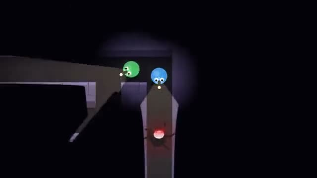

# Flashlight Maze

Find three keys in the dark. Something is following you. A multiplayer starter game from [Multiplayer Agent](https://multiplayeragent.com): 2D, co-op, 1–4 players, with bot teammates that fill empty seats.

## How it plays

Every run is a new pitch-black maze. Your flashlight shows the way, but the thing in the maze sees it too. Shine it in its face to slow it down, switch it off to hide. Find the three keys, then get anyone to the exit. If it catches a friend, stand by them to set them free.

**Controls:** WASD or arrows to walk, mouse to aim the flashlight, F or right-click for the light; on touch, drag to walk and tap the light button.

## Make it yours in the Game Builder

Open the [Game Builder](https://multiplayeragent.com), choose **Start from a starter game** and pick Flashlight Maze. It opens as version 1 in your studio, ready to play and publish. Then ask for changes, for example:

- Give flashlights a battery that runs down
- Add a second stalker after the first key
- Make it a haunted house with doors that creak open

## Run it yourself

1. Get a free publishable key (`pk_…`) at [multiplayeragent.com](https://multiplayeragent.com).
2. In `index.html`, put it in place of `pk_REPLACE_ME` in the `MP_CONNECT` block.
3. Open `index.html` in a browser. No build step and no server needed.

Without a key it still runs, offline with bot teammates.

## How it is built

- One `index.html`. The comment at the top of the script maps the code and explains the multiplayer.
- Each maze is built from a seed (`maze()`): the size, the number of keys and how many loops it has are in `CONFIG`, and so are the stalker's speed, sight and hearing.
- **Host-run rules:** The host's browser runs the stalker, the keys and the exit; if it leaves, the next player takes over.
- **Bots:** Bot teammates search the maze, free you when you're caught and lead it away.
- **Leaderboard:** The team's fastest escape.
- **Live sync:** Everyone's flashlight lights the maze for the whole team.
- `?attract` runs it offline with bots only. The preview video is recorded from it.

## License

MIT.
